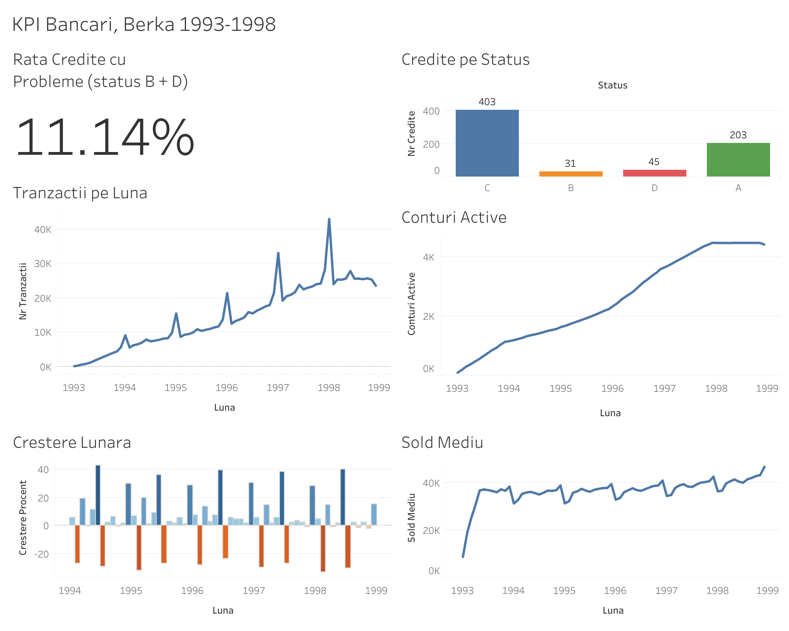

# berka-kpi-dashboard

# Dashboard KPI pe date bancare (Berka)

Proiect de portofoliu: indicatori de tranzacții și credite pe un set de date bancare cehe (1993-1998), calculați în SQL, automatizați cu Python și afișați într-un dashboard Tableau.

**Dashboard live:** https://public.tableau.com/app/profile/emilia.popovici/viz/KPIBancariBerka/Dashboard1

## Date
Berka (Czech Financial Dataset), de pe Kaggle. Fișierele .csv trebuie să fie în `data/`.

## Conținut
- `docs/cerinte.md`: întrebări de business, definiții, criterii de acceptanță, validare
- `sql/`: 6 interogări pentru indicatori
- `python/load_data.py`: încarcă datele în Postgres (Supabase)
- `python/run_queries.py`: rulează interogările și exportă CSV-uri în `output/`

## Cum se rulează
1. `pip install -r requirements.txt`
2. Se creează `.env` cu `DB_URL=...` (exemplu în `.env.example`)
3. `python python/load_data.py`
4. `python python/run_queries.py`
5. Se deschid CSV-urile din `output/` în Tableau

## Indicatori
Tranzacții pe lună, conturi active, creștere lunară, sold mediu, credite pe status, rata creditelor cu probleme (status B și D).